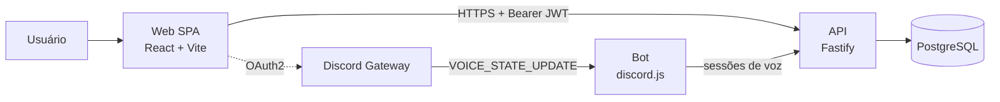

# StudyRooms

> Nome provisório. Controle de hábitos de estudo com salas de estudo integradas ao Discord: o tempo em canal de voz vira sessão de estudo, e um dashboard mostra a evolução por semana, mês, trimestre, semestre e ano, além dos horários em que você mais e menos estuda.

**Status:** Fase 1 em planejamento (nenhum código ainda).

## Problema e motivação

Estudar de forma consistente depende de enxergar a própria rotina. Este projeto nasceu de uma necessidade real: acompanhar a sequência de dias e as horas dedicadas à construção do meu portfólio. Eu sou o usuário número 1, e os dados do dashboard são reais.

O diferencial é a integração com o Discord: quem estuda em um canal de voz tem o tempo registrado automaticamente, sem precisar lembrar de iniciar um timer. Na Fase 2, as salas de estudo ganham presença em tempo real ("quem está estudando agora") e ranking semanal ao vivo.

## Escopo

### Fase 1: o tracker
- Login com Discord (OAuth2) e vínculo do `discord_id`
- Bot que registra entrada, saída e troca de canal de voz como sessões de estudo
- Timer manual no site para estudos fora da call (mesma tabela de sessões)
- Cálculo de **streak** correto no fuso do usuário, incluindo sessões que cruzam a meia-noite
- Dashboard por período (semana, mês, trimestre, semestre, ano) e **mapa de calor por dia da semana × hora**
- Consentimento explícito: só registra quem se vinculou ao site

### Fase 2: tempo real (depois da Fase 1 em produção)
- Presença nas salas, timer sincronizado entre dispositivos, ranking ao vivo
- Redis pub/sub, SSE, teste de carga (k6) documentado

## Stack

| Camada | Tecnologia | Decisão |
|---|---|---|
| Repositório | Monorepo pnpm workspaces + Turborepo | [ADR 0001](docs/adr/adr-0001-monorepo.md) |
| Front-end | React + Vite + TypeScript (SPA), TanStack Router/Query, Tailwind, shadcn/ui | [ADR 0002](docs/adr/adr-0002-spa.md) |
| Autenticação | Discord OAuth2 + JWT (access curto + refresh rotativo) | [ADR 0003](docs/adr/adr-0003-jwt.md) |
| API | Node + Fastify + Zod (OpenAPI gerado dos schemas) | planejado |
| Banco | PostgreSQL + Drizzle ORM | planejado |
| Bot | discord.js (intent `guild_voice_states`, não privilegiada) | planejado |
| Testes | Vitest, Testing Library, Playwright, Testcontainers | planejado |
| Infra | Docker, GitHub Actions, hospedagem 100% gratuita | [ADR 0004](docs/adr/adr-0004-hospedagem.md) (proposto) |

TypeScript de ponta a ponta: os schemas Zod em `packages/shared` são a fonte única de verdade dos contratos entre front, API e bot.

## Arquitetura (visão de containers)



Estrutura do repositório:

```
apps/
  web/      # SPA
  api/      # API HTTP
  bot/      # bot do Discord
packages/
  shared/   # schemas Zod, tipos, lógica pura (streak, fatiamento de sessões)
  db/       # schema e migrations
  config/   # tsconfig, eslint, prettier
docs/
  adr/      # decisões de arquitetura
```

## Decisões de modelagem (princípios)

- **Tempo sempre em UTC no banco.** O fuso IANA do usuário fica no perfil e é aplicado apenas na leitura (streak, agregações, mapa de calor).
- **Dado bruto preservado.** Guardamos as sessões como o bot as observou e aplicamos regras (canal AFK, mutado por muito tempo, transmissão) na hora do cálculo, para poder mudar o critério sem perder histórico.
- **Sessões órfãs.** Se o bot cair com alguém na call, o evento de saída se perde. A inicialização reconcilia o estado atual da call com as sessões abertas e um heartbeat fecha as órfãs.
- **Operações idempotentes.** Parar uma sessão duas vezes não cria dois registros.
- **Sem histórico retroativo.** O Discord não informa o tempo passado em call; os dados começam quando o bot entra no servidor.

## Como rodar

Em construção. Meta: `docker compose up` sobe banco, API, bot e web localmente, com um `.env.example` documentado.

## Práticas do projeto

- Trunk-based development com branches curtas e PRs (revisados por mim mesmo)
- Conventional Commits
- ADRs em `docs/adr/` para cada decisão relevante
- TDD na lógica de streak e fatiamento de sessões (virada de meia-noite, fusos, horário de verão, sessões órfãs)
- CI no GitHub Actions: lint, typecheck, testes
- Kanban no GitHub Projects com milestones por fase

## ADRs

| # | Título | Status |
|---|---|---|
| [0001](docs/adr/adr-0001-monorepo.md) | Monorepo TypeScript | Aceito |
| [0002](docs/adr/adr-0002-spa.md) | SPA com React + Vite | Aceito |
| [0003](docs/adr/adr-0003-jwt.md) | Autenticação com JWT | Aceito |
| [0004](docs/adr/adr-0004-hospedagem.md) | Hospedagem gratuita | Proposto |
| 0005 | Modelo de sessões: dado bruto, regras na leitura | Planejado |
| 0006 | Estratégia de fuso horário | Planejado |
| 0007 | Reconciliação de sessões órfãs do bot | Planejado |
| 0008 | Agregação direta vs rollups / materialized views | Planejado |
| 0009 | SSE vs WebSocket (Fase 2) | Planejado |

## Roadmap

- [ ] Fase 0: spike do bot (loga entrada e saída de voz no console) e deploy de prova
- [ ] Fase 1: tracker completo, em produção, usado diariamente
- [ ] Fase 2: salas de estudo em tempo real

## O que eu faria diferente

_A preencher ao longo do projeto._

## Privacidade

O bot só registra tempo de quem vinculou a conta ao site e aceitou o acompanhamento. Nenhuma mensagem é lida, e a intent de conteúdo de mensagens não é usada.
