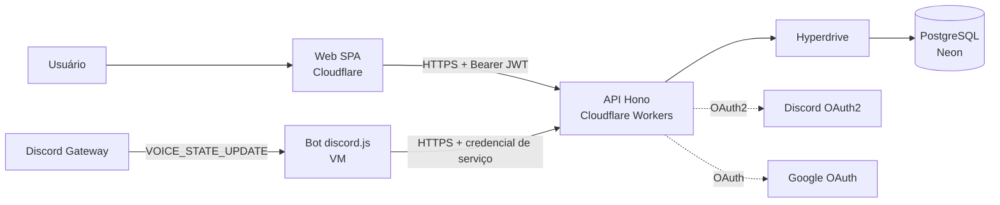

# StudyRooms

> Nome provisório. Controle de hábitos de estudo com salas de estudo integradas ao Discord: registre o tempo manualmente, por um timer no site ou automaticamente em canal de voz, e acompanhe a evolução por semana, mês, trimestre, semestre e ano, além dos horários em que você mais e menos estuda.

**Status:** Fase 0 em andamento (`apps/bot` loga entrada, saída e troca de canal de voz no console, sem gravar nada). Hospedagem e regras de produto decididas em 2026-11-06; o provedor final do bot segue pendente até a F0-06.

## Problema e motivação

Estudar de forma consistente depende de enxergar a própria rotina. Este projeto nasceu de uma necessidade real: acompanhar a sequência de dias e as horas dedicadas à construção do meu portfólio. Eu sou o usuário número 1, e os dados do dashboard são reais.

O diferencial é a integração com o Discord: quem estuda em um canal de voz tem o tempo registrado automaticamente, sem precisar lembrar de iniciar um timer. Na Fase 2, as salas de estudo ganham presença em tempo real ("quem está estudando agora") e ranking semanal ao vivo.

## Escopo

### Fase 1: o tracker

Aberta a qualquer pessoa, sem allowlist.

- **Três formas de registrar tempo:**
  - **Manual**, com início e fim, inclusive retroativa; pode ser corrigido e excluído;
  - **Timer no site**, enquanto a aplicação está aberta, sem precisar vincular o Discord; ao fechar o site, o tempo é guardado até o último sinal recebido;
  - **Discord**, pelo bot, que registra quem está na call e por quanto tempo.
- Login por **Google e Discord** (OAuth2), sem e-mail e senha: a conta sem Discord entra por Google, e o login com Discord vincula o `discord_id`. Detalhes no ADR de login (F1-45)
- Bot em **vários servidores**: a pessoa escolhe em qual colocá-lo, e o `guild_id` é guardado
- Só o canal AFK fica de fora do cálculo
- **Sem limite de duração de sessão:** pode durar 24 h, se não for para o AFK
- Tempo sobreposto entre timer, call e registro manual conta uma vez: união dos intervalos, com os registros brutos preservados
- **Streak** no fuso do usuário: o dia conta com 15 min, incluindo sessões que cruzam a meia-noite, e o dia de hoje só quebra a streak ao terminar. Tempo manual retroativo conta, marcado como manual
- Dashboard por período de calendário (semana de domingo a sábado, mês, trimestre, semestre, ano) e **mapa de calor por dia da semana × hora**
- Consentimento explícito e obrigatório para a coleta pelo bot, global na Fase 1, com o servidor de origem visível em cada registro do bot. Quem recusa usa timer e registro manual; só o bot fica de fora

### Fase 2: tempo real (depois da Fase 1 em produção)
- Presença nas salas, timer sincronizado entre dispositivos, ranking ao vivo
- Redis pub/sub, SSE e teste de carga (k6) a reavaliar sob Workers, no ADR 0009

## Stack

| Camada | Tecnologia | Decisão |
|---|---|---|
| Repositório | Monorepo pnpm workspaces + Turborepo | [ADR 0001](docs/adr/adr-0001-monorepo.md) |
| Front-end | React + Vite + TypeScript (SPA), TanStack Router/Query, Tailwind, shadcn/ui, na Cloudflare | [ADR 0002](docs/adr/adr-0002-spa.md), [ADR 0004](docs/adr/adr-0004-hospedagem.md) |
| Autenticação | Google OAuth + Discord OAuth2 + JWT (access curto + refresh rotativo) | [ADR 0003](docs/adr/adr-0003-jwt.md); ADR de login (F1-45) |
| API | Hono (sujeito à prova) + Zod (OpenAPI gerado dos schemas) em Cloudflare Workers | [ADR 0010](docs/adr/adr-0010-api-cloudflare-workers.md) |
| Banco | PostgreSQL + Drizzle ORM; Neon via Hyperdrive | [ADR 0004](docs/adr/adr-0004-hospedagem.md) |
| Bot | discord.js (intent `guild_voice_states`; a F0-03 confirma se `guilds` também é necessária), em container; VM Oracle Always Free como primeira opção | [ADR 0004](docs/adr/adr-0004-hospedagem.md), a confirmar pela F0-06 |
| Testes | Vitest, Testing Library, Playwright, Testcontainers | planejado |
| Infra | Wrangler, Docker (bot e banco local), GitHub Actions, hospedagem gratuita | [ADR 0004](docs/adr/adr-0004-hospedagem.md) |

TypeScript de ponta a ponta: os schemas Zod em `packages/shared` são a fonte única de verdade dos contratos entre front, API e bot.

Planos gratuitos verificados em **2026-11-06**. Eles mudam: se algum mudar, reconfirme e siga o plano de saída do [ADR 0004](docs/adr/adr-0004-hospedagem.md).

## Arquitetura (visão de containers)



SPA e API no mesmo Worker é uma possibilidade a provar na F0-07.

Estrutura do repositório. Hoje só existem `apps/bot` (spike de log de voz) e `docs/`; o restante está marcado como planejado:

```
apps/
  web/      # planejado: SPA
  api/      # planejado: API HTTP (Hono em Cloudflare Workers)
  bot/      # bot do Discord (spike de log de voz; container planejado)
packages/   # planejado
  shared/   # planejado: schemas Zod, tipos, lógica pura (streak, fatiamento de sessões)
  db/       # planejado: schema e migrations
  config/   # planejado: tsconfig, eslint, prettier
docs/
  adr/          # decisões de arquitetura
  planejamento/ # roadmap
```

## Decisões de modelagem (princípios)

- **Tempo sempre em UTC no banco.** O fuso IANA do usuário fica no perfil e é aplicado apenas na leitura (streak, agregações, mapa de calor).
- **Dado bruto preservado.** Guardamos os registros como foram observados e aplicamos as regras (canal AFK, união de intervalos, mínimo de 15 min) na hora do cálculo, para poder mudar o critério sem perder histórico. A exceção é o registro manual, que a própria pessoa pode corrigir e excluir.
- **Só o necessário.** O bot grava quem está na call e por quanto tempo. Mudo e transmissão não são gravados; por isso, um critério baseado neles não poderia ser aplicado ao histórico depois.
- **Sessões órfãs.** Se o bot cair com alguém na call, o evento de saída se perde. A inicialização reconcilia o estado atual da call com as sessões abertas, e as órfãs são fechadas conforme o ADR 0007. Sinais frequentes não tocam o banco a cada envio: o sinal fica em memória na VM, com gravação periódica a cada 30 min ([ADR 0004](docs/adr/adr-0004-hospedagem.md)).
- **Operações idempotentes.** Parar uma sessão duas vezes não cria dois registros.
- **Sem histórico retroativo de voz.** O Discord não informa o tempo passado em call; os dados de voz começam quando o bot entra no servidor. Tempo anterior só entra pelo registro manual.

## Como rodar

Hoje só existe o spike do bot. Requer Node 24 (`>=24.19.0`) e pnpm 11.22.0, fixados em `package.json`, e um `.env` na raiz, copiado do `.env.example` e preenchido:

```
pnpm install --frozen-lockfile
pnpm typecheck
pnpm test
pnpm --filter @studyrooms/bot start
```

O último comando conecta ao Discord e fica rodando até `Ctrl+C`. O bot precisa ter sido convidado com o escopo `bot` e poder ver o canal de voz.

Meta, **ainda não disponível** (o `compose` e o Wrangler não existem no repositório):

1. Iniciar o Docker (abaixo).
2. `docker compose up` sobe o banco local e o bot.
3. Wrangler sobe a API e o front localmente.

### Iniciar o Docker

O motor é o Docker Engine dentro da distro WSL `docker-engine`. **O início é manual, por escolha do usuário:** faça isto a cada vez que ligar o PC, antes de usar o Docker.

1. **Ligar:** abra um terminal, rode o comando abaixo e **deixe esse terminal aberto** enquanto usar o Docker. Sem ele, a distro desliga em menos de 30 s, mesmo depois de um comando `docker`, e os containers param junto.

   ```
   wsl -d docker-engine
   ```

2. **Usar:** em outro terminal, rode `docker` e `docker compose` normalmente. O motor roda na distro `docker-engine`.
3. **Desligar:** feche esse terminal (ou digite `exit`), ou rode `wsl --terminate docker-engine`.

**Limitação:** caminhos do Windows em argumentos (como os de `-f` e `-v`) não são convertidos. Prefira caminhos relativos, a partir da pasta do projeto.

## Práticas do projeto

- Branches permanentes `dev` e `main`: o que está estável vai para `main`. Commits direto em `dev`, sem PR
- Conventional Commits
- ADRs em `docs/adr/` para cada decisão relevante
- TDD na lógica de streak e fatiamento de sessões (virada de meia-noite, fusos, horário de verão, sessões órfãs)
- CI no GitHub Actions: lint, typecheck e testes serão adicionados na F1-03
- Kanban no GitHub Projects com milestones por fase

## ADRs

| # | Título | Status |
|---|---|---|
| [0001](docs/adr/adr-0001-monorepo.md) | Monorepo TypeScript | Aceito |
| [0002](docs/adr/adr-0002-spa.md) | SPA com React + Vite | Aceito |
| [0003](docs/adr/adr-0003-jwt.md) | Autenticação com JWT | Aceito |
| [0004](docs/adr/adr-0004-hospedagem.md) | Hospedagem gratuita | Aceito, com ressalva: provedor final do bot a confirmar pela F0-06 |
| 0005 | Modelo de sessões: dado bruto, regras na leitura | Planejado |
| 0006 | Estratégia de fuso horário | Planejado |
| 0007 | Reconciliação de sessões órfãs do bot | Planejado |
| 0008 | Agregação direta vs rollups / materialized views | Planejado |
| 0009 | SSE vs WebSocket (Fase 2) | Planejado |
| [0010](docs/adr/adr-0010-api-cloudflare-workers.md) | API em Cloudflare Workers | Aceito quanto a Workers; Hono sujeito à prova |
| 0011 | Escrita do bot pela API (resolve o item 6 do ADR 0003) | Planejado |

## Decisões em aberto

- **Provedor final do bot.** Oracle Always Free é a primeira opção; a decisão sai com o resultado da F0-06.
- **Destino do backup.** O dump roda pela VM; o destino depende de levantamento ainda pendente.

## Roadmap

- [ ] Fase 0: spike do bot (loga entrada e saída de voz no console) e deploy de prova
- [ ] Fase 1: tracker completo, em produção, usado diariamente
- [ ] Fase 2: salas de estudo em tempo real

Detalhes em [docs/planejamento/roadmap.md](docs/planejamento/roadmap.md).

## O que eu faria diferente

_A preencher ao longo do projeto._

## Privacidade

O bot só registra tempo de quem vinculou a conta ao site e aceitou o acompanhamento, e grava apenas presença e duração em call. Nenhuma mensagem é lida, e a intent de conteúdo de mensagens não é usada. Quem recusa o consentimento continua usando timer e registro manual.

Revogar o consentimento para a coleta e mantém o histórico. Excluir a conta apaga tudo, com backups expirando em até 30 dias.
